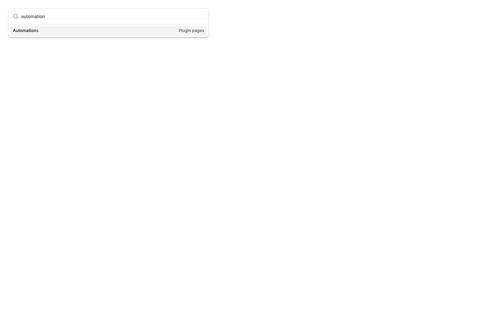
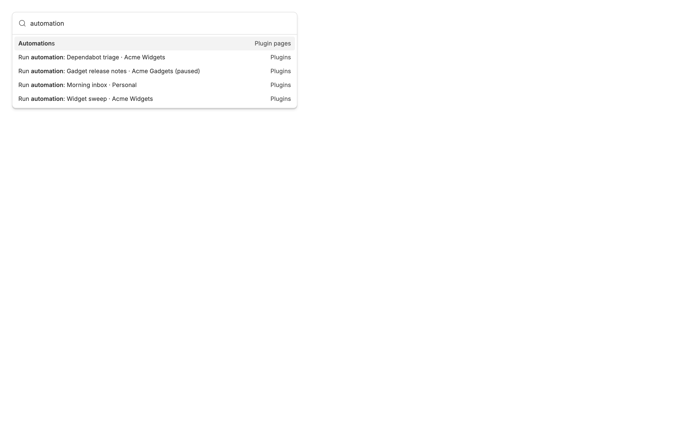
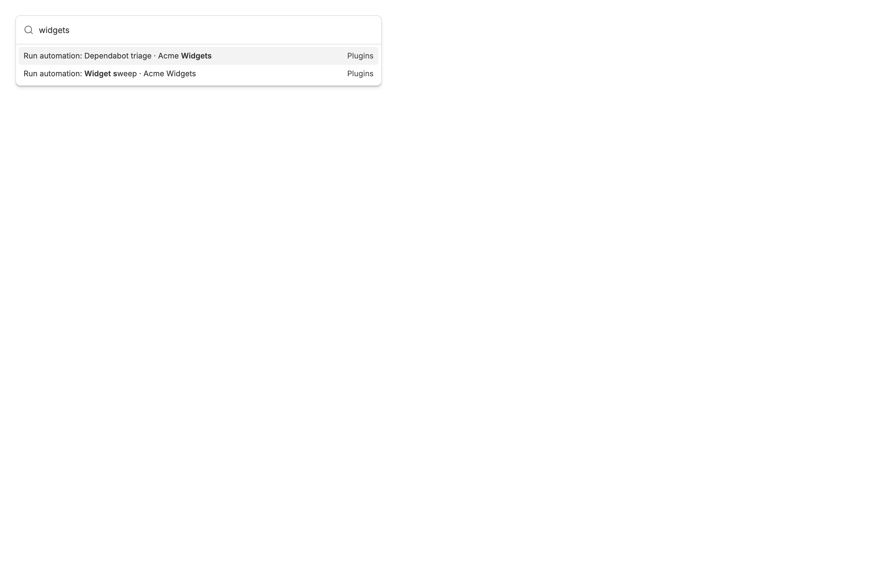

<!-- Written by `npm run screenshots` in bb-plugins. Edit the stories there, not this file. -->

# Automation Palette

Run any bb automation from the quick palette, without opening the Automations page.

Source: [`bb-plugin-automation-palette`](https://github.com/danielbachhuber/bb-plugins/tree/main/bb-plugin-automation-palette)

## Quick palette

### Without the plugin

Without the plugin, typing "automation" finds only the Automations page, where you open an automation and press Run now.

### With the plugin

With it, every automation in every project is a row. Selecting one starts it, as its schedule would. A paused automation keeps its row.

### By project

Typing a project's name lists that project's automations.

