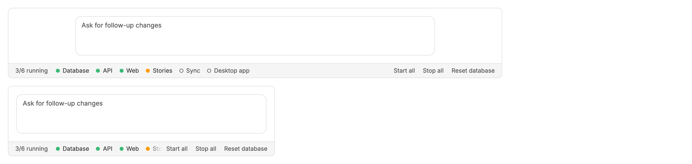
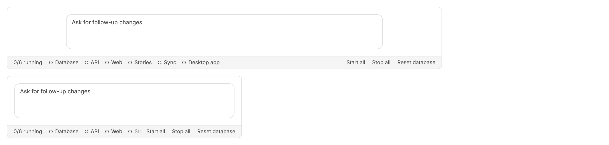
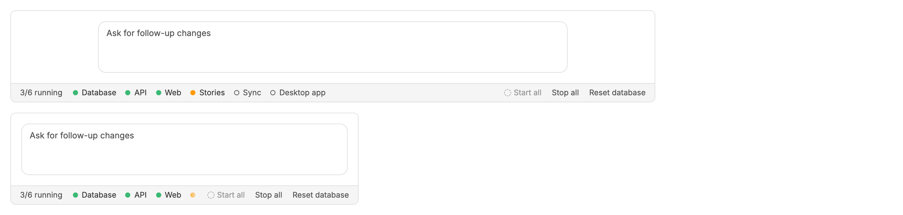
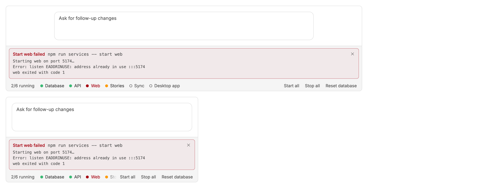
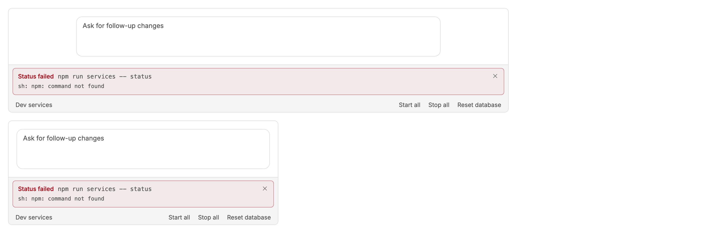
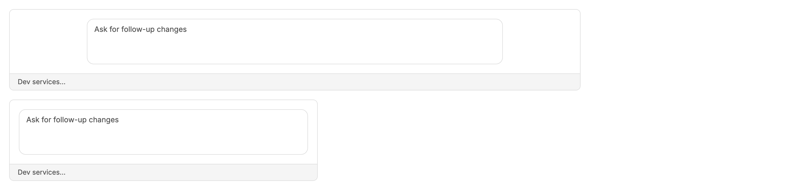

<!-- Written by `npm run screenshots` in bb-plugins. Edit the stories there, not this file. -->

# Dev Bar

A status bar along the bottom of a thread that shows which of the checkout's dev services are running, and starts, stops, or restarts them.

Source: [`bb-plugin-dev-bar`](https://github.com/danielbachhuber/bb-plugins/tree/main/bb-plugin-dev-bar)

## Strip

### Running

Four of six services up, one still starting, with the repository's own buttons at the end.

### All stopped

Every service stopped, as in a fresh worktree.

### Busy

Start all is running, so its button shows a spinner.

### Action failed

A start that exited with an error shows the last lines it printed.

### Status failed

The status command failed, so there are no services to show.

### Loading

Before the first status arrives.

