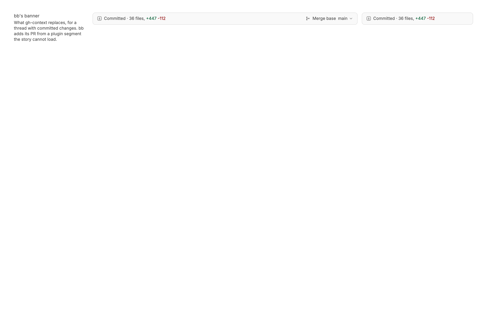
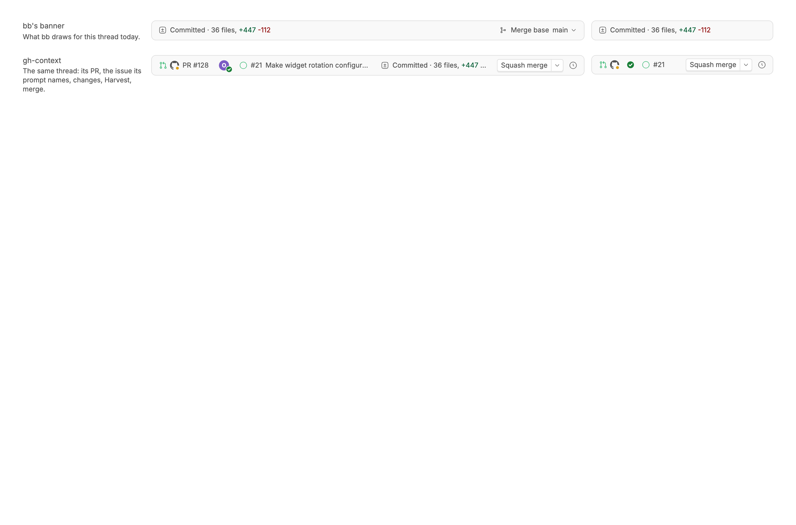
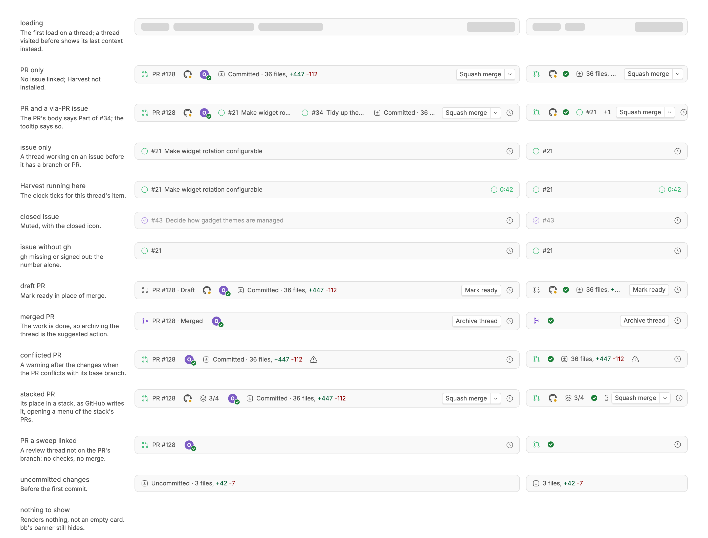
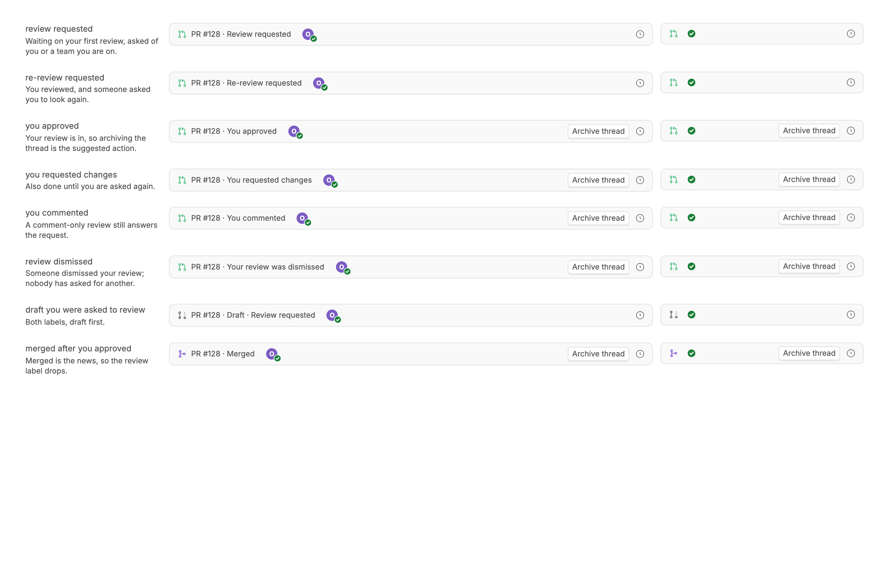
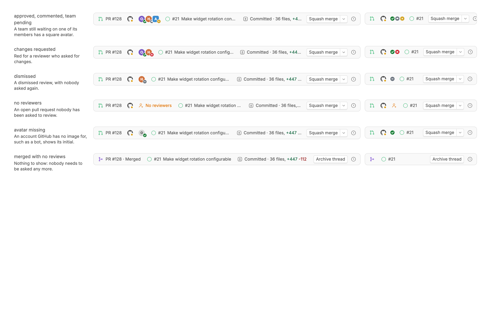

<!-- Written by `npm run screenshots` in bb-plugins. Edit the stories there, not this file. -->

# GitHub Context

Replaces bb's composer banner with the thread's pull request, its stack and reviewers, linked issues, its changes, and a Harvest timer.

Source: [`bb-plugin-gh-context`](https://github.com/danielbachhuber/bb-plugins/tree/main/bb-plugin-gh-context)

## Banner

### Default

### Comparison

### States

### Review states

### Reviewers

The pull request's reviewers, right after it: each avatar carries a badge for where that review stands. Hovering an avatar names the reviewer and their review.

