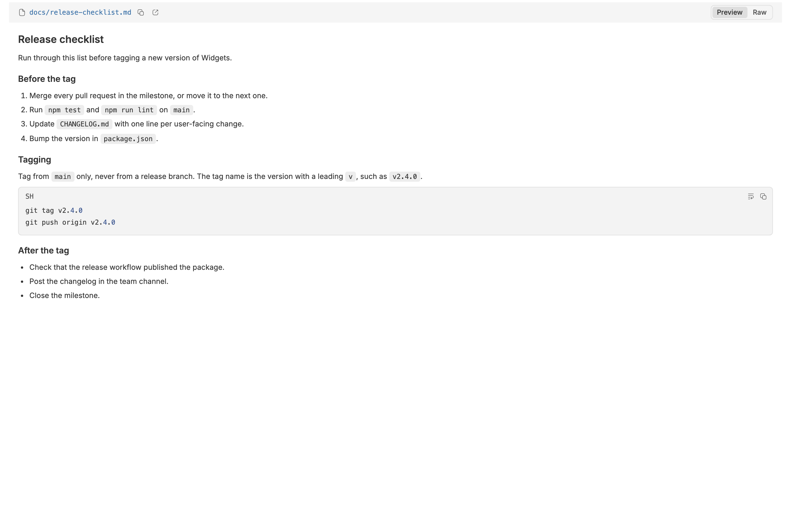
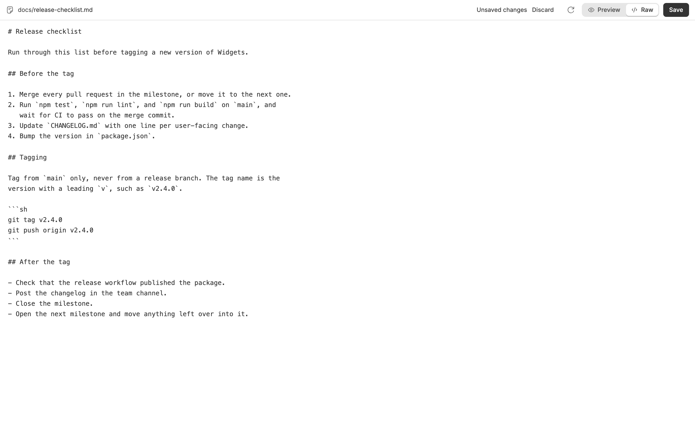
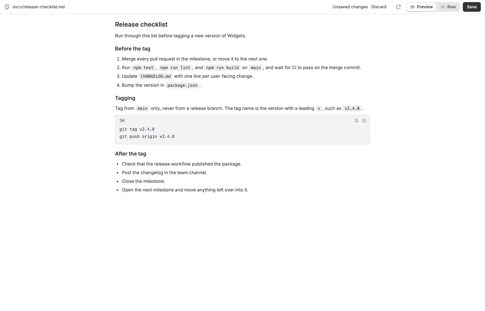
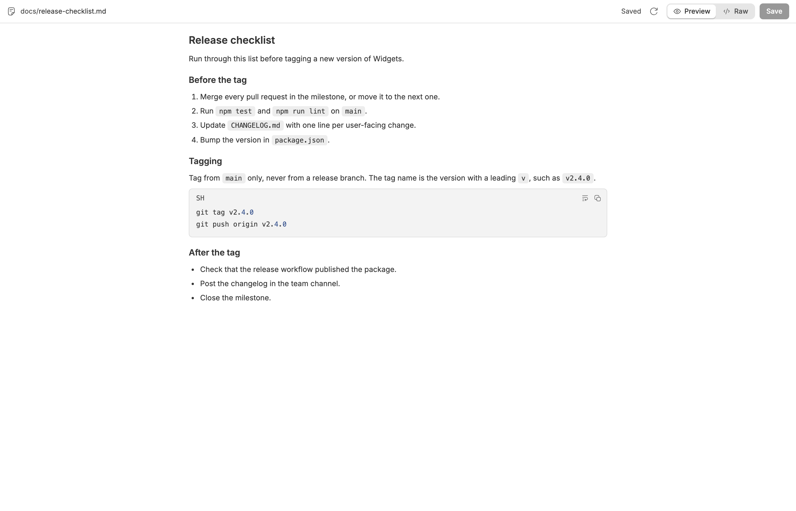
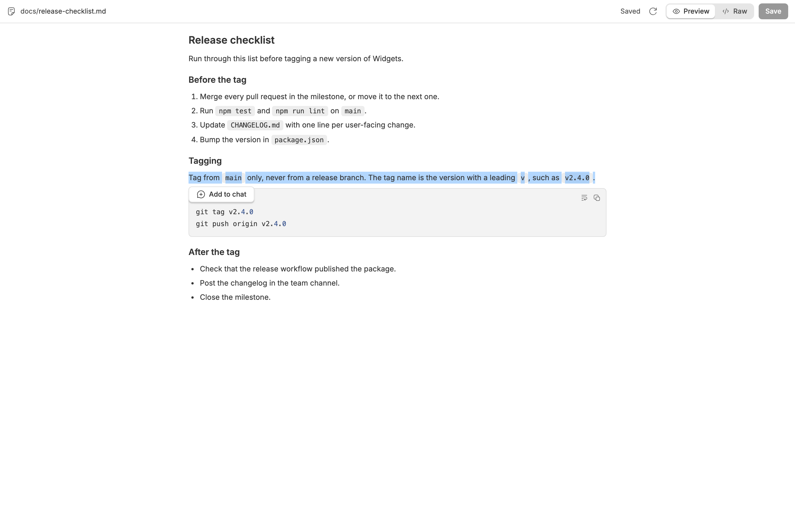
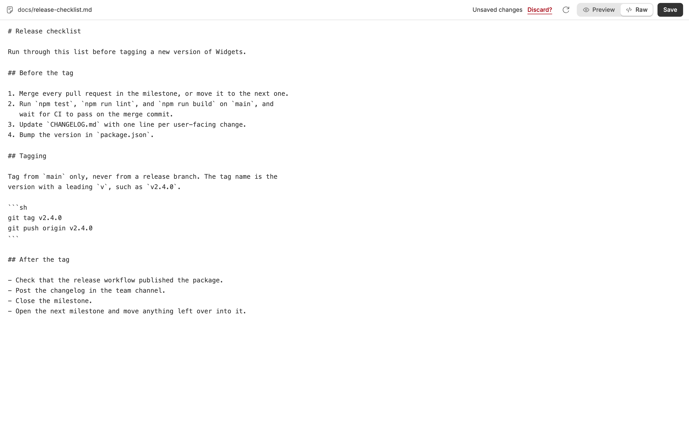
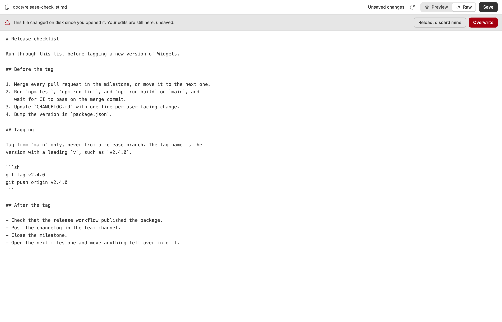

<!-- Written by `npm run screenshots` in bb-plugins. Edit the stories there, not this file. -->

# Markdown Editor

Edit markdown files in the tab bb opens them in, preview the result, and save with Cmd+S without overwriting an agent's edits.

Source: [`bb-plugin-markdown-editor`](https://github.com/danielbachhuber/bb-plugins/tree/main/bb-plugin-markdown-editor)

## Tab

### Without the plugin

Without the plugin: bb opens a markdown file read-only, with a Preview and Raw toggle and no way to change the text.

### Raw with unsaved changes

The same file in Raw, edited in place: two lines changed, Unsaved changes in the header, and Save ready.

### Preview with unsaved changes

Preview renders the unsaved text before it reaches disk.

### Saved

Saved, in Preview.

### Add to chat

A paragraph selected in Preview, with Add to chat under it to quote it into the composer.

### Discard armed

Discard pressed once: it asks before throwing the edits away.

### Conflict

An agent changed the file on disk while it had unsaved edits. Save stopped, and the banner asks which copy to keep.

