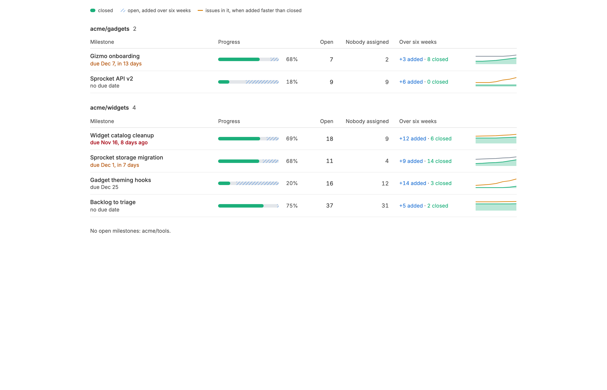
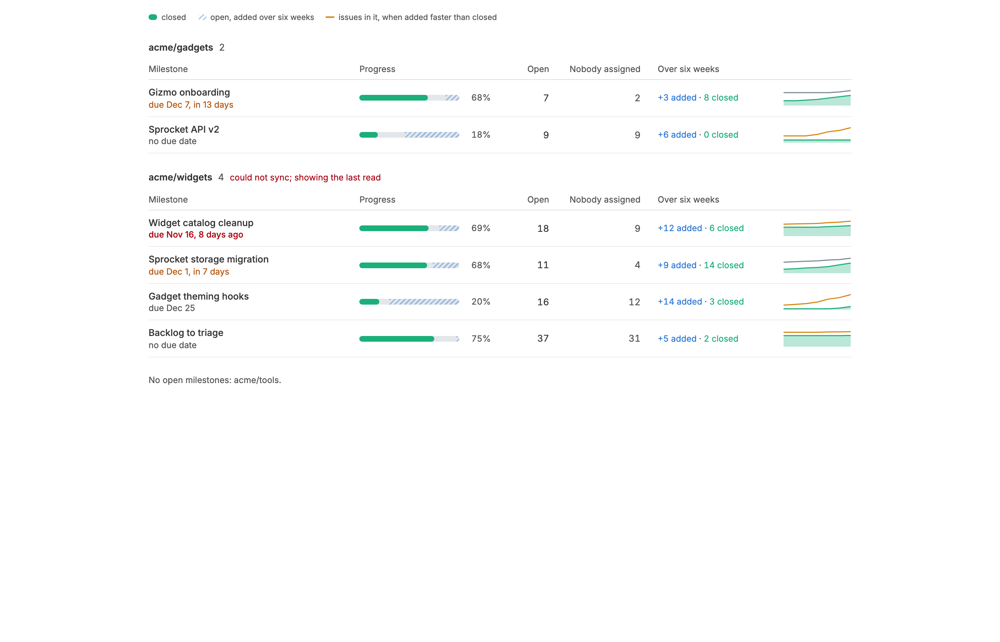
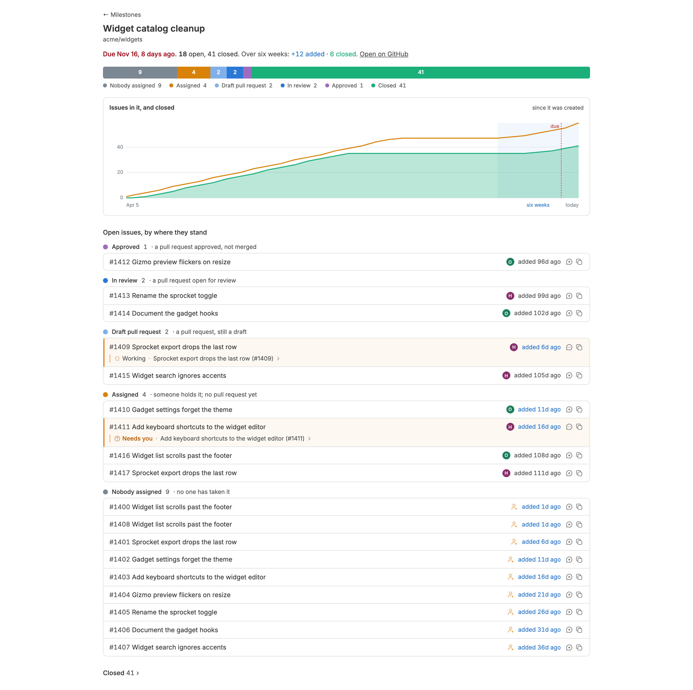
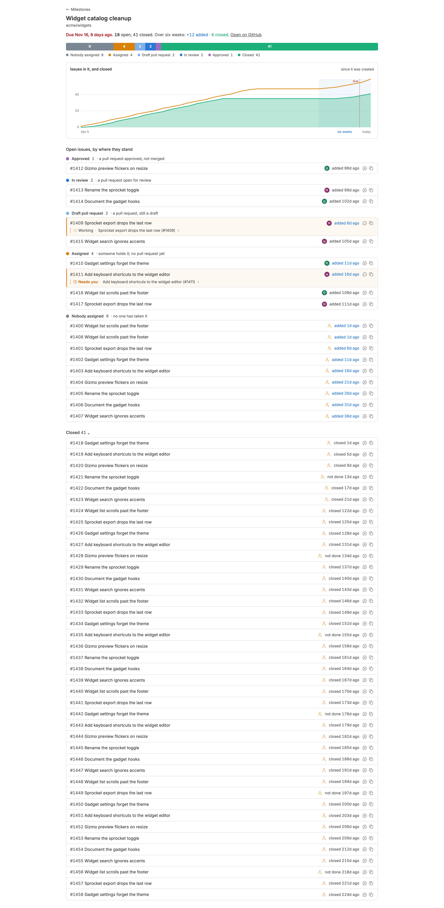
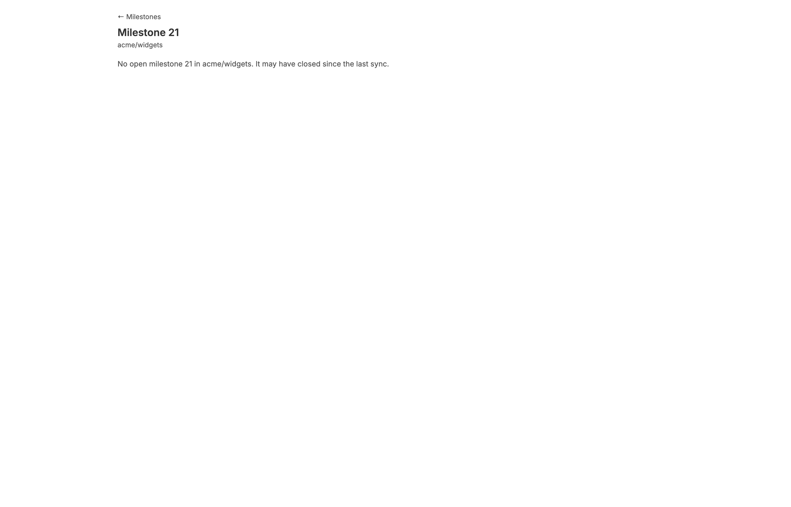

<!-- Written by `npm run screenshots` in bb-plugins. Edit the stories there, not this file. -->

# Milestone Sweep

Every open GitHub milestone in the repositories checked out here: how far along each is, and where each of its issues stands.

Source: [`bb-plugin-milestone-sweep`](https://github.com/danielbachhuber/bb-plugins/tree/main/bb-plugin-milestone-sweep)

## Page

### Milestones

Every open milestone in each repository checked out here, due soonest first, with the repositories that have none named at the end.

### First sync

Before the first sync has finished.

### Sync failed

A repository that could not be read on the last sync keeps the milestones read before, flagged beside its name.

### Milestone

A milestone's page, opened from its row: past due, with where each open issue stands and its history since it was created. Each issue row starts or opens a thread and copies its link; two already have a thread.

### Milestone closed open

The same milestone with its closed issues opened under the open ones.

### Milestone gone

A milestone that closed since the last sync.

