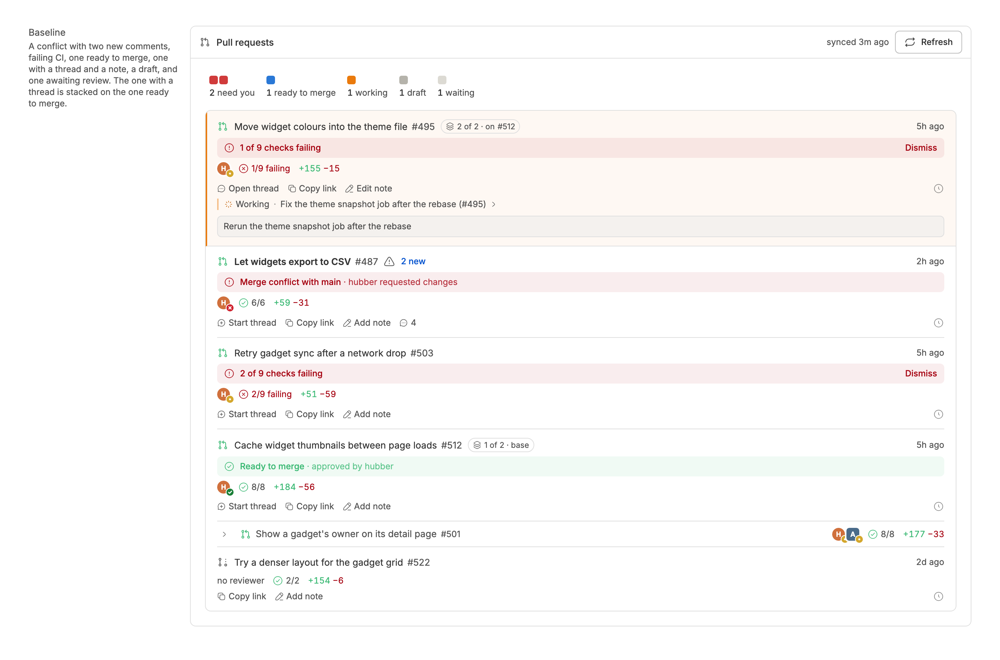
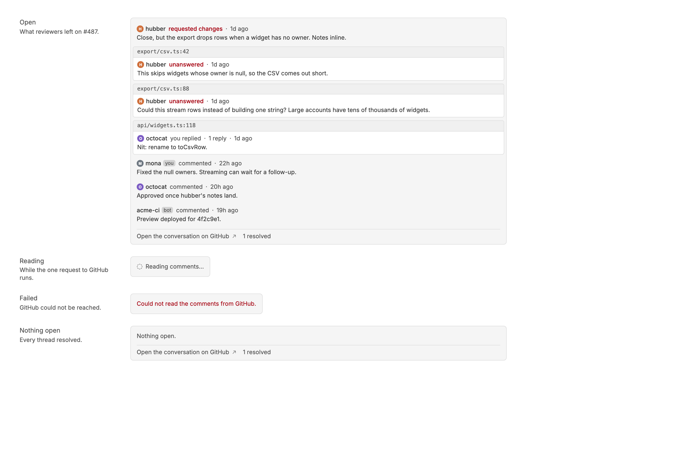
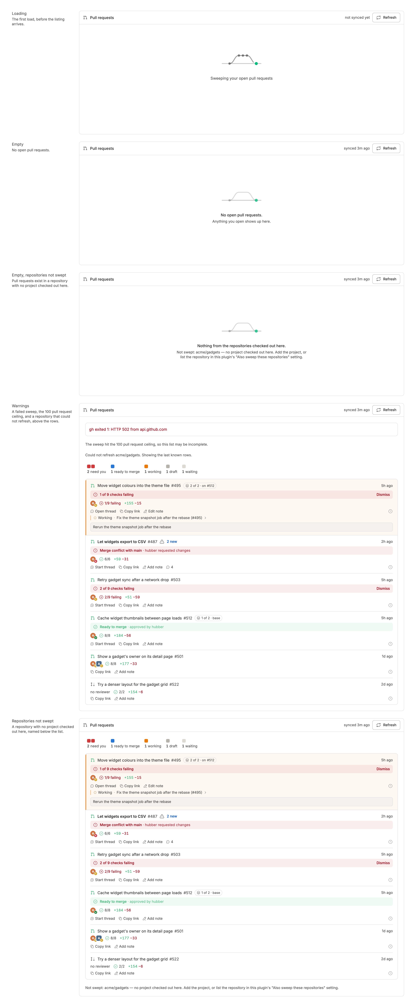
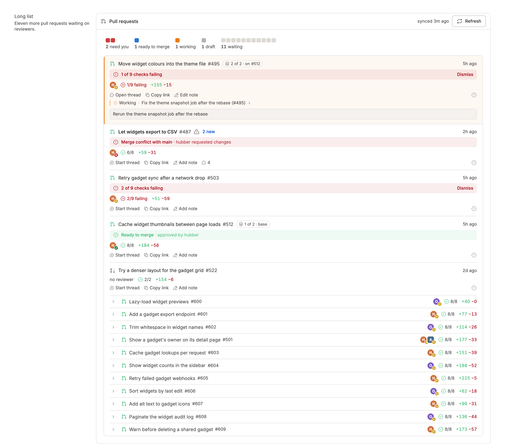

<!-- Written by `npm run screenshots` in bb-plugins. Edit the stories there, not this file. -->

# PR Sweep

Open pull requests you authored in one list, newest first with in-progress ones on top and those waiting on others closed to one line at the bottom, with local notes, new comment counts, review comments a click away, a Dismiss for failing checks you cannot fix, and where a stacked pull request sits in its stack. Clicking the sync time shows what the past hour of sweeps cost against GitHub's rate limit. Its counts also sit in bb's top bar on every page, and clicking them opens the list. Needs gh-context.

Source: [`bb-plugin-pr-sweep`](https://github.com/danielbachhuber/bb-plugins/tree/main/bb-plugin-pr-sweep)

## Pr list

### Baseline

A typical day. The one with a thread is pinned at the top; the rest follow newest first, each with a red banner naming what stops it or a green one when it can merge, and the one awaiting review closes to one line at the bottom. The one with a thread is stacked on the one ready to merge, so each has a chip: "1 of 2 · base" and "2 of 2 · on #512".

### Rows

Every run the list can draw: needs you, ready to merge, working, drafts, and waiting, including one stale after six days with its reviewer. The one being worked on is on top and the waiting ones close to one line at the bottom, the stale one first, and the rest are newest first. Then every flag in the banner, the list across two repositories, a thread being started with a timer running, and the panel without Harvest.

### Comments drawer

The drawer a row's comment count opens. The review that requested changes comes first, then the threads still open, unanswered ones marked in red, then general comments. Resolved threads wait behind "1 resolved". Each entry opens on GitHub. A comment longer than three lines is cut there, with Show more under it to read the rest in place. Then a long list, which opens on its newest 10 under "Show 37 earlier", the drawer while it reads, when GitHub fails, and with nothing open.

### States

Loading, empty, and the notices the panel shows above and below its rows.

### Long list

A long list: the open rows first, then every pull request waiting on a reviewer closed to one line at the bottom, newest first, with nothing folded.

