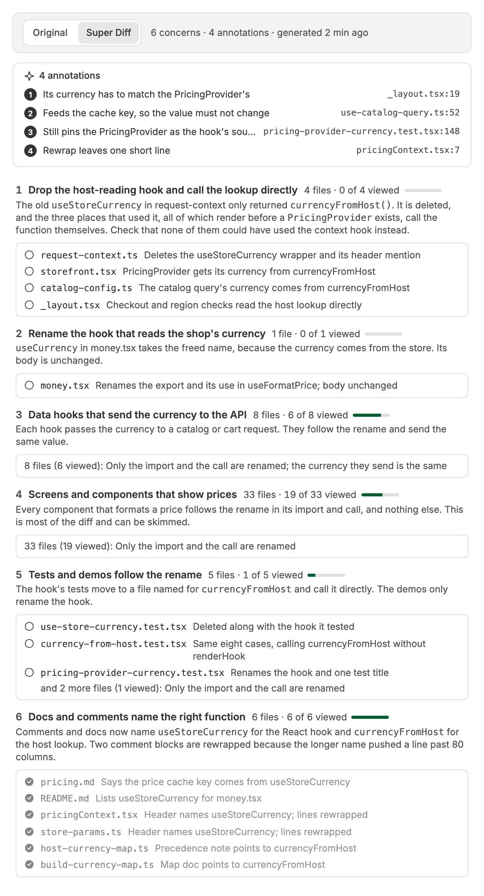
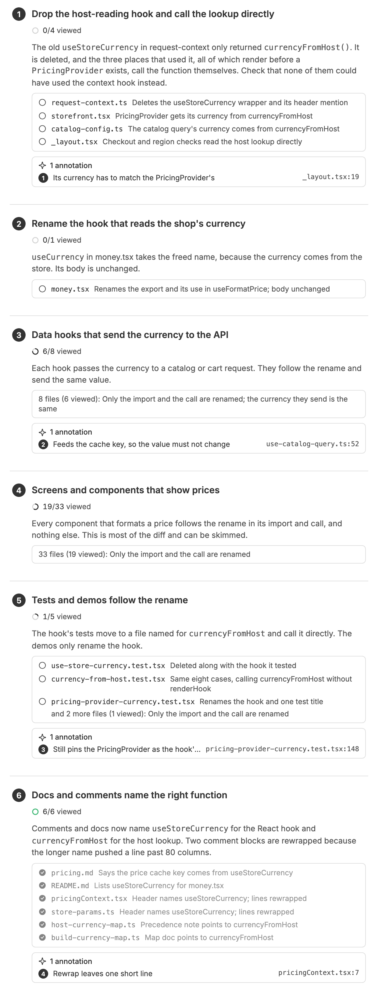
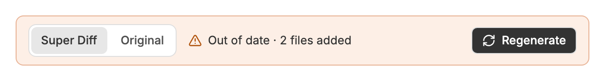
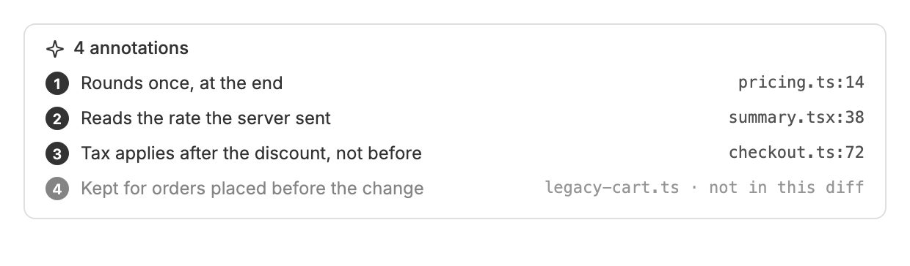
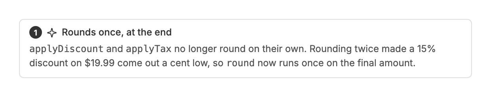
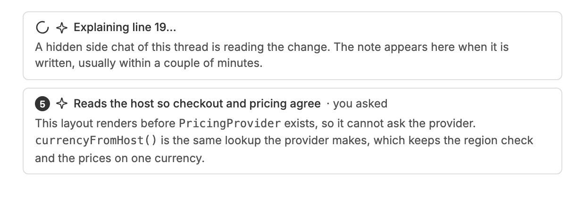

<!-- Written by `npm run screenshots` in bb-plugins. Edit the stories there, not this file. -->

# Super Diff

Group the Diff tab by concern, with an explanation for each group and notes on tricky code, plus a note on any line you ask about.

Source: [`bb-plugin-super-diff`](https://github.com/danielbachhuber/bb-plugins/tree/main/bb-plugin-super-diff)

## Super diff

### Overview

A Super Diff of a 57-file rename: the row with every concern listed, the first concern with what each file's change is and its annotation, and one of its files in bb's diff with that annotation under the line it explains.

### All concerns

All six concerns of the same Super Diff, each with what its files' changes are, how many of them Diff Viewed has marked viewed, and its annotations. In bb, each concern's diff cards follow its heading.

### Not generated

Before anything is generated: bb's own diff, with Generate Super Diff on the left of the row.

### Generating

While the thread's agent reads the diff and writes the Super Diff.

### Showing super diff

A Super Diff is showing: the toggle switches back to bb's own list, the line counts what the agent wrote, and each concern is listed with how many of its files are viewed. Clicking one jumps to it; the one at the top of the list is highlighted.

### Out of date

Two files have joined the diff since the Super Diff was written, so the row turns amber and offers Regenerate.

### Annotation list

A concern's annotations, under its file list: each one's number, title, and line, which jumps to its card. One note's line has left the diff.

### Annotation card

A note card as it sits under the line it explains, inside the diff.

### Explain this

Explain this: the card under a line while a fork of the thread writes its note, and the note once it is written, marked as one you asked for.

### Concern file list

A concern's heading with Diff Viewed installed: its viewed count, then each file and what its change does. Files that change the same mechanical way share one line.

