<!-- Written by `npm run screenshots` in bb-plugins. Edit the stories there, not this file. -->

# Tokenomics

Understand what your threads cost in tokens and time, so you can cut what isn't worth it. Each thread's header shows a sparkline of its token use that opens a summary of which of your messages used the most tokens and time. Once a thread's context passes a size you set, a meter above the composer offers to compact it, and the sidebar counts those threads. A Tokenomics page charts tokens by hour or day, shows where turn time went, and ranks threads by use. The bb tokenomics command prints the same numbers for scripts.

Source: [`bb-plugin-tokenomics`](https://github.com/danielbachhuber/bb-plugins/tree/main/bb-plugin-tokenomics)

## Page

### Past day

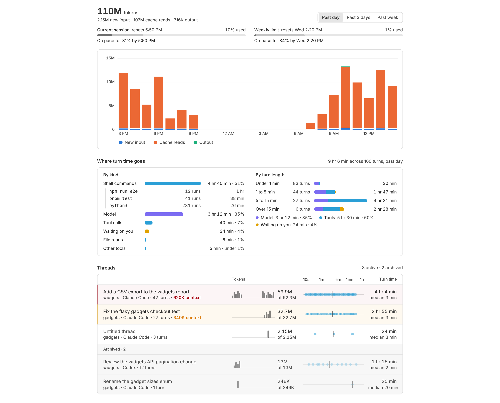

### Past day hovered

The past day with a busy hour hovered, so its tooltip shows.

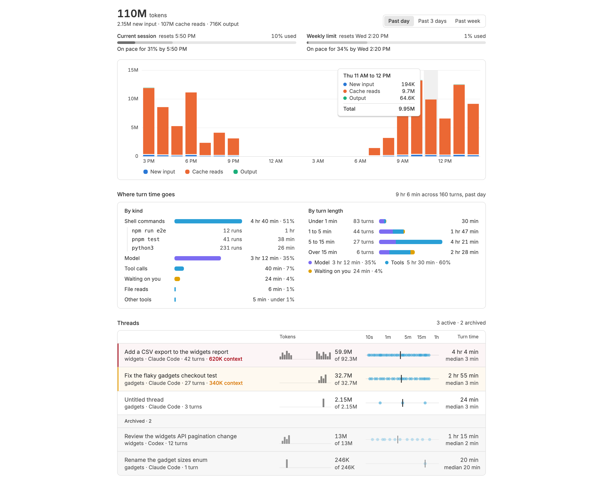

### Past three days

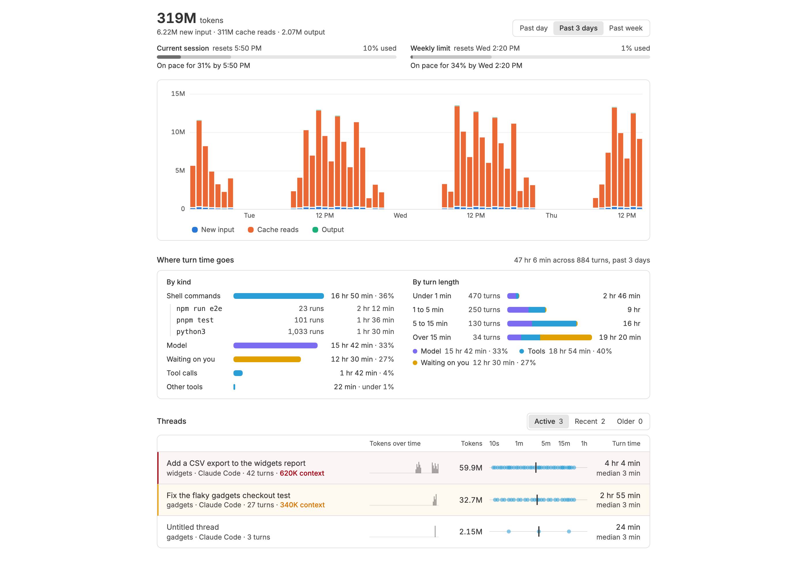

### Past week

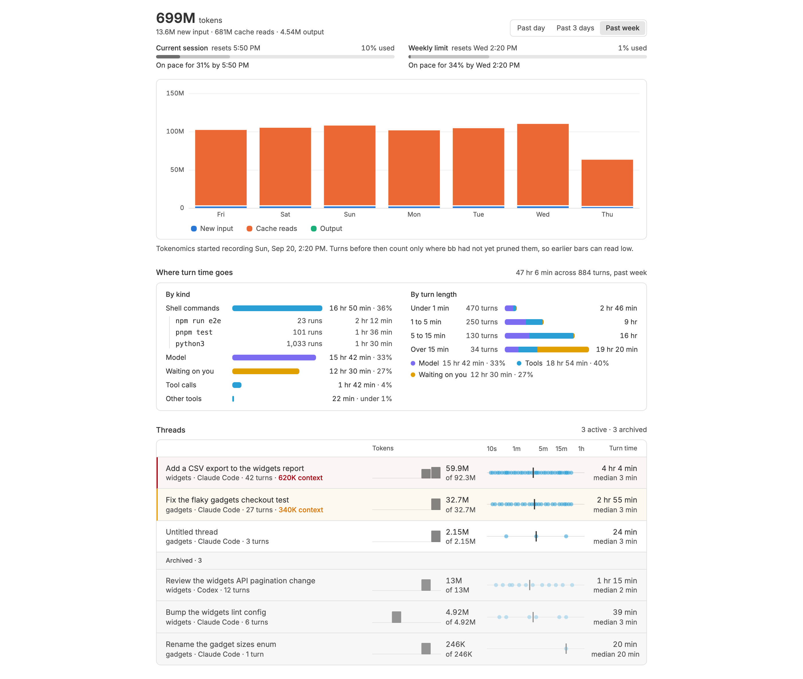

### Recent threads

Threads archived in the past three days, dimmed and labeled Archived.

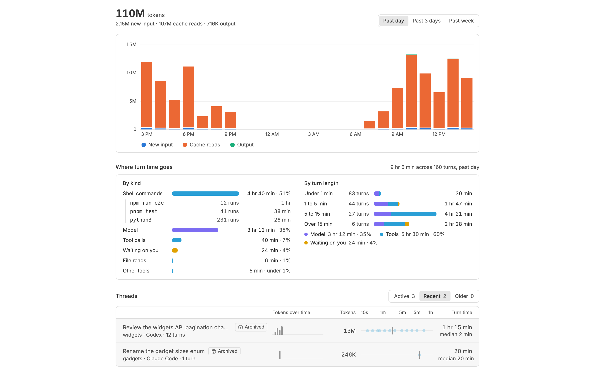

### Older threads

Over the past week, a thread archived more than three days ago lists under Older.

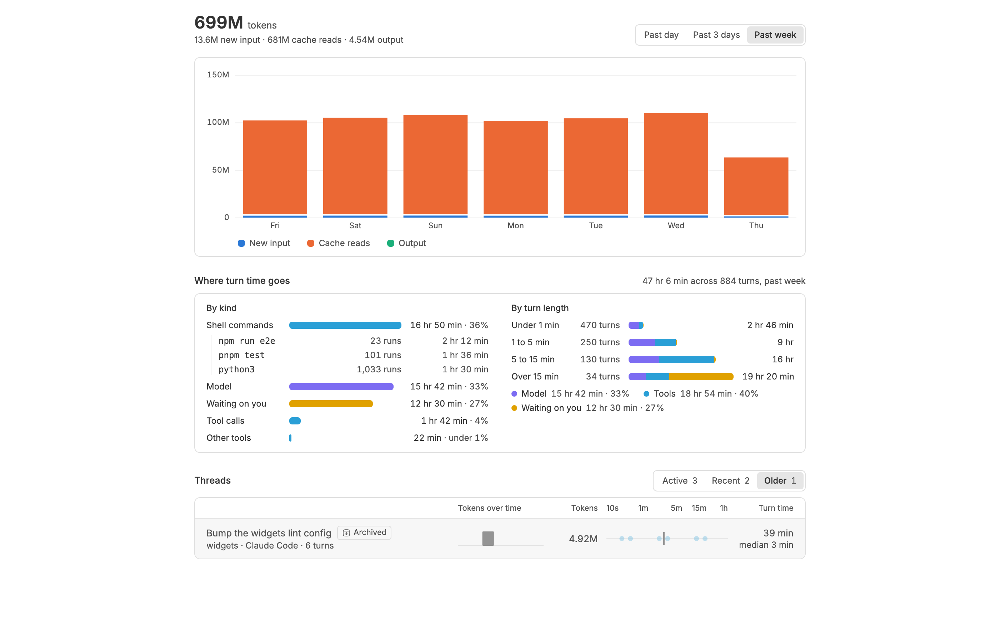

### Empty

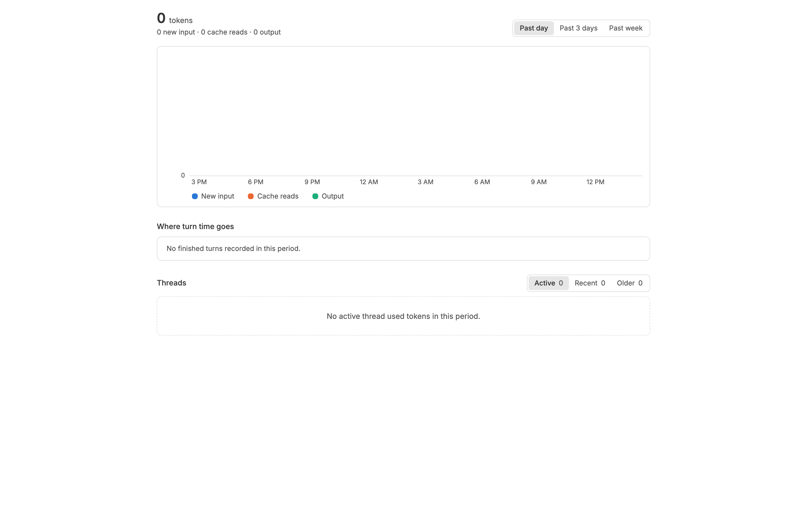

### Header count

### Header summary

The popover's contents, drawn open.

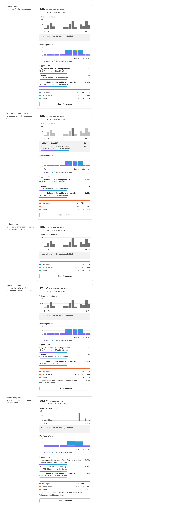

### Header open

The button where bb draws it, in a thread header's action row, with its summary open on the busiest stretch.

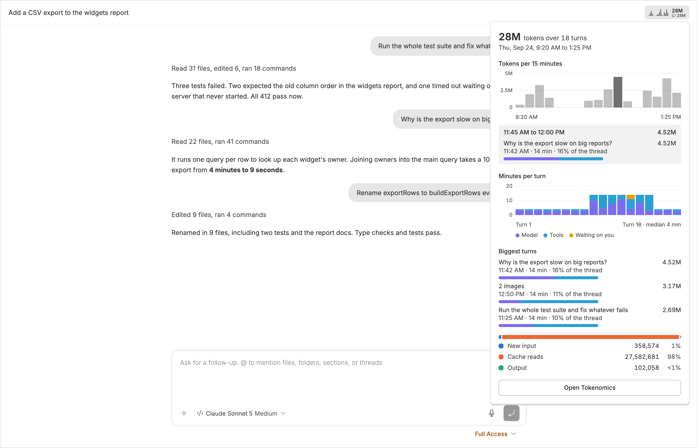

### Context meter states

The meter above a thread's composer once its context passes the warning setting, 300K tokens here, and red past the error setting, 550K, with a button that compacts the thread.

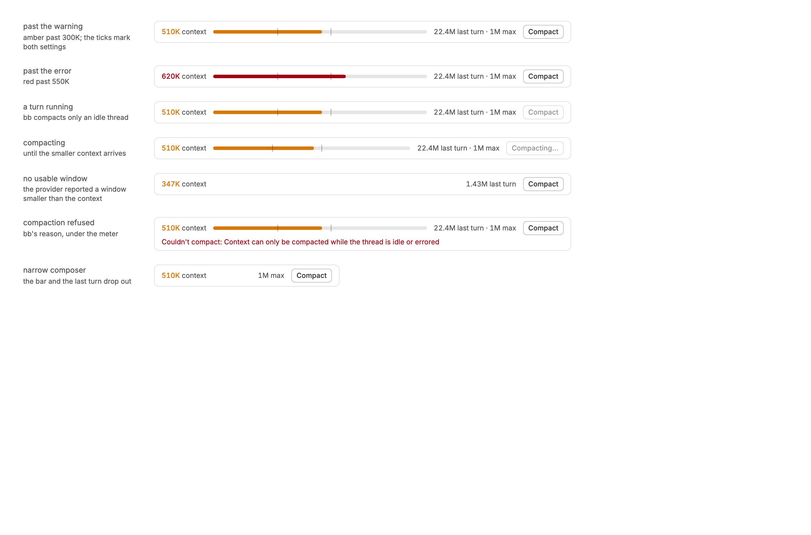

### Thread with meter

A thread whose context has grown past the error setting: the header's sparkline and total, and the meter above the composer with Compact.

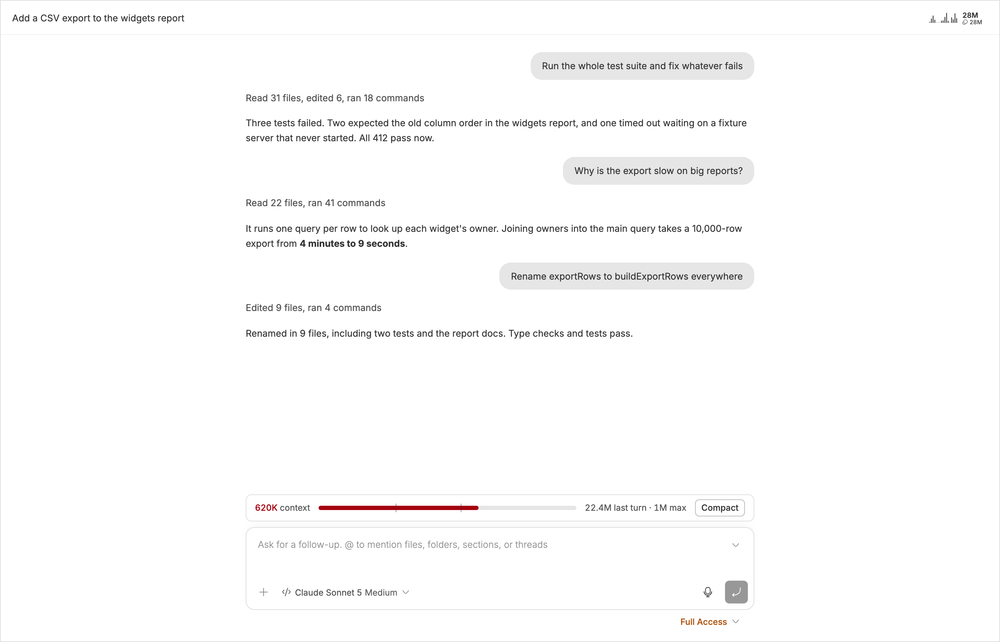
