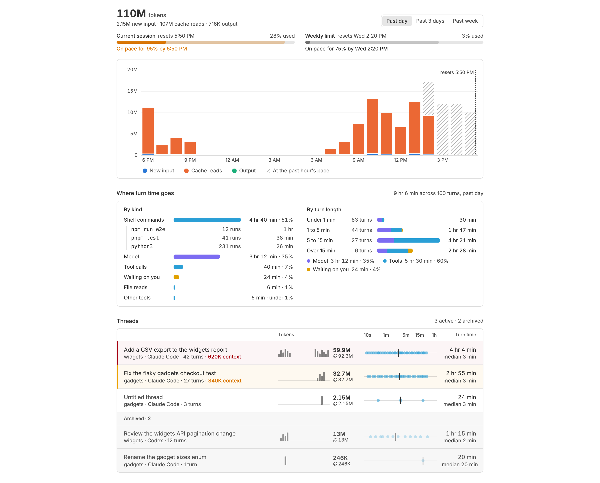
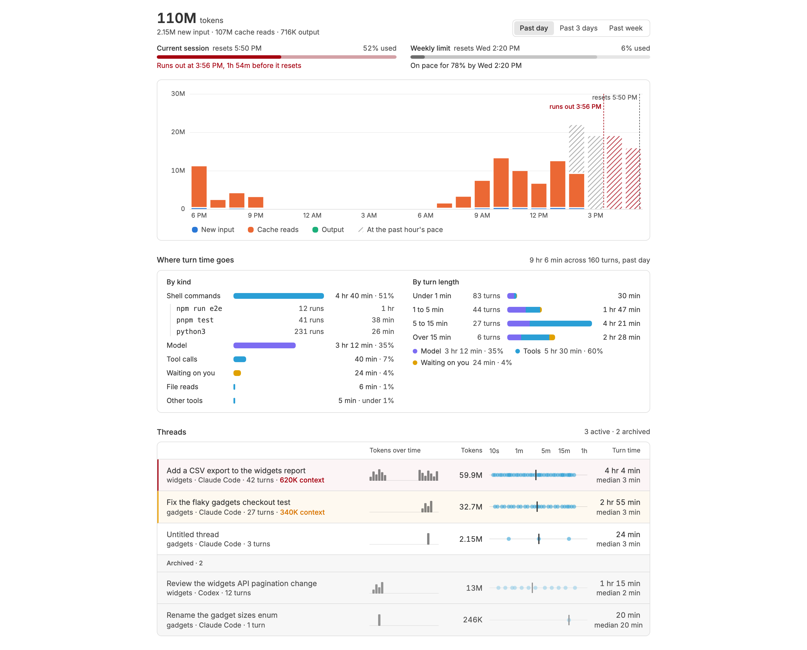
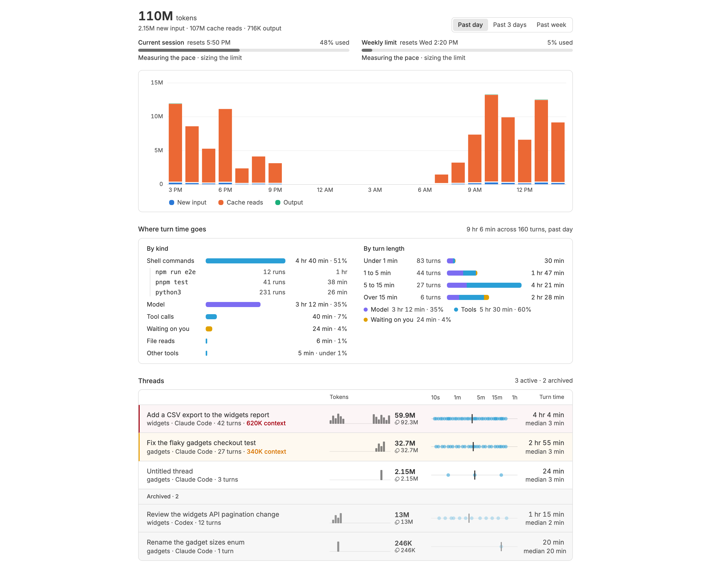
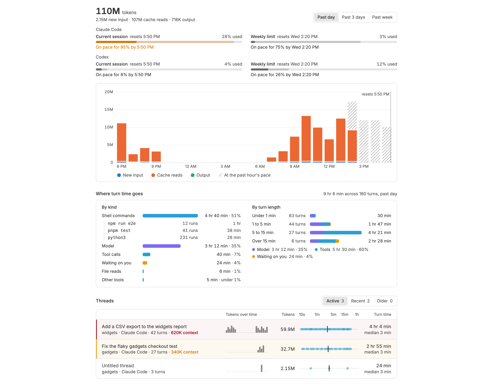
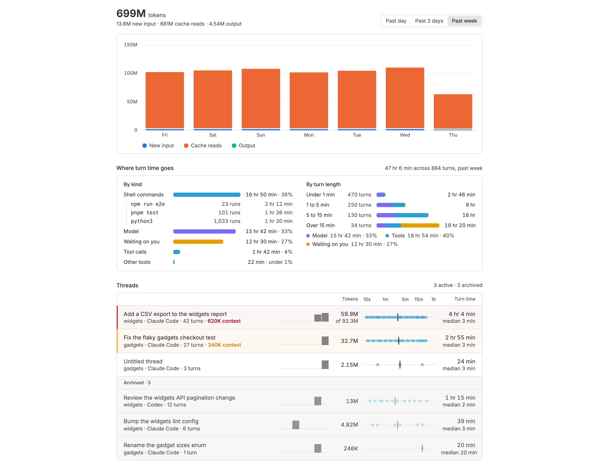
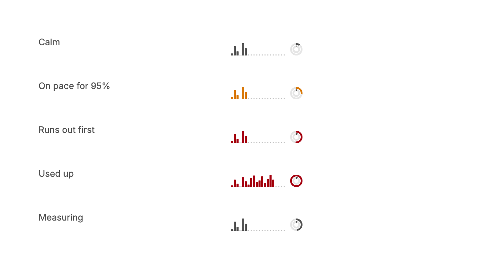

<!-- Written by `npm run screenshots` in bb-plugins. Edit the stories there, not this file. -->

# Tokenomics

See what your threads cost in tokens and time, and whether your subscription's session and weekly limits will last until they reset.

Source: [`bb-plugin-tokenomics`](https://github.com/danielbachhuber/bb-plugins/tree/main/bb-plugin-tokenomics)

## Page

### Past day

### Past day hovered

The past day with a busy hour hovered, so its tooltip shows.

### Limit on pace

A session on pace for 95% by its reset: the meter turns amber, and the chart runs on to the reset with hatched bars at the past hour's pace.

### Limit runs out

A session that runs out before it resets: red, with the hatched bars red past the point it runs out.

### Limit measuring

Right after Tokenomics starts reading the limits, before there's a pace to project.

### Limit two subscriptions

Two subscriptions: each one's meters sit under its provider's name.

### Past three days

### Past week

### Archived threads

Over the past week, every thread in one list: active threads first, then the archived ones under their own heading, dimmed.

### Empty

### Header count

### Header summary

The popover's contents, drawn open.

### Header open

The button where bb draws it, in a thread header's action row, with its summary open on the busiest stretch.

### Context meter states

The meter above a thread's composer once its context passes the warning setting, 300K tokens here, and red past the error setting, 550K, with a button that compacts the thread.

### Thread with meter

A thread whose context has grown past the error setting: the header's sparkline and total, and the meter above the composer with Compact.

### Title bar

The session in bb's title bar, after the other plugins' buttons: its tokens per 15 minutes from its start to its reset, so the empty space is the time left, and two rings for the percent used: the session inside, the week outside. Once it's amber or red, the time left fills with hatched bars at the past hour's pace. Hovering shows the page's meters; clicking opens the page.

